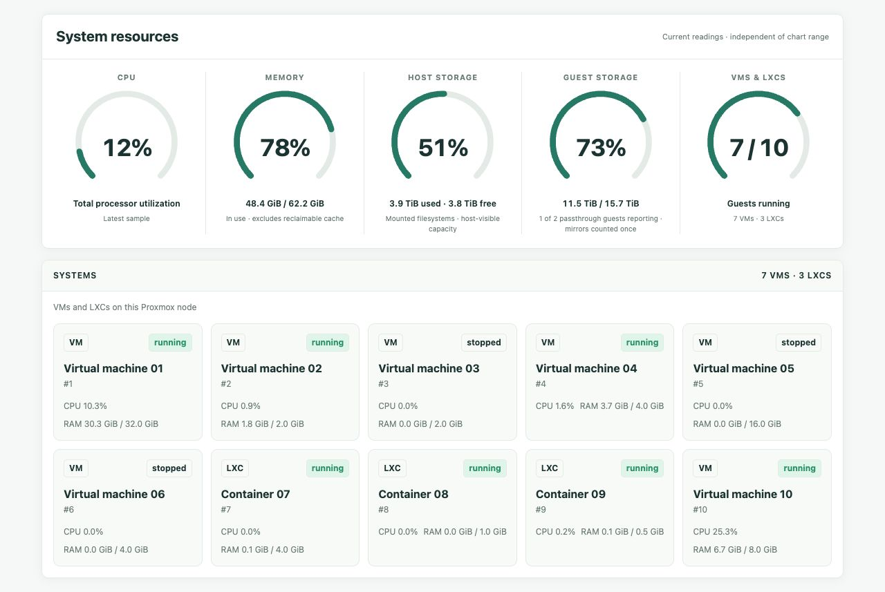

# neofand

Hardware monitoring and per-component fan control for Linux workstations.
Live dashboards bring together temperatures, CPU/GPU load, memory pressure,
fan speeds, power, storage usage and system events.

## Choose your setup

| Platform | Support | Guide |
|---|---|---|
| Mac Pro 7,1 on Linux | Apple SMC fan control, PSU power, cover interlock, NVIDIA/AMD sensors and two-sided chassis diagrams | [Fan daemon](#quick-start-mac-pro) · [Dashboard](dashboard/README.md) |
| Linux / ThinkStation P620 | Read-only CPU, RAM/PSI, hwmon and NVIDIA/AMD telemetry, storage and events | [Linux adapter](dashboard/linux/README.md) |
| Proxmox LXC | Native web/API services with a separate physical-host collector; node, VM/container and task status | [LXC installation](dashboard/lxc/README.md) |

Missing hardware readings remain unavailable. The Linux adapter and Proxmox
collectors are read-only; fan control belongs to the Mac Pro daemon.

## See it running

**Mac Pro with three RTX A6000s**


[Memory / PSU view](docs/screenshots/mac-pro-memory-sensors.jpg) ·
[ThinkStation P620 / RTX 3090](docs/screenshots/p620-sensors.jpg)

Live captures with identifying information cropped out. Chassis artwork and
sensor positions are illustrative; see [capture notes](docs/screenshots/README.md).

**Proxmox host, VM/LXC inventory, and resource overview**



Guest names and IDs are anonymized, and host/network identity is omitted. Resource readings and guest states are unchanged.

Bare-metal Docker hosts also have a **Portainer** page with container state, health checks, Compose projects, CPU/RAM usage and a link to the management UI. The page reads a host-generated snapshot; the web container has no Docker socket or Portainer credentials. [Setup and access model](dashboard/PORTAINER.md).

## What’s included

- **Sensors and history:** load bars, temperatures, fan speeds, board/system power
  where available, memory usage/pressure, auto/live controls and sample timestamps.
- **Storage:** raw drives, boot/system badges, used/available space, category
  indexing with a metadata cache, and ZFS mirror/pool accounting.
- **GPU builder:** combine PCIe cards and Apple MPX modules in chassis views,
  with dimensions, slot occupancy and collision checks. [GPU library](dashboard/assets/gpu-library/README.md).
- **Events:** host warnings and restart history; telemetry gaps alone do not
  establish a power outage.

## Quick start: Mac Pro

Requires Linux, Rust 1.75+, root for fan control, and a working fan driver.
T2 Macs need a compatible patched `applesmc` driver; see the
[requirements](docs/fan-control.md#requirements).

```bash
cargo build --release
sudo install -m 0755 target/release/neofand /usr/local/bin/neofand
sudo install -m 0644 neofand.service /etc/systemd/system/neofand.service
sudo install -m 0644 neofand.conf.macpro71 /etc/neofand.conf
sudo systemctl daemon-reload
sudo systemctl enable --now neofand
sudo journalctl -u neofand -b --no-pager
```

Review the [worked config](neofand.conf.macpro71) and startup log before relying
on cooling. Tune thresholds for your GPUs, keep the cover interlock enabled,
and verify each fan’s source. NVIDIA card fan control is opt-in; the optional
startup power cap defaults to disabled.

Build with `--features web` to include the daemon’s telemetry store and web
console. Use the platform guides above for the full hardware dashboard.

```bash
neofand --status  # Read the published snapshot without probing hardware
```

## Documentation

[Fan configuration and troubleshooting](docs/fan-control.md) ·
[Mac Pro hardware findings](MACPRO71-FINDINGS.md) ·
[Dashboard deployment](dashboard/README.md) ·
[GPU library and builder](dashboard/assets/gpu-library/README.md)

GPL-3.0-or-later. Forked from [T2FanRD](https://github.com/GnomedDev/T2FanRD).

## Security

Read [SECURITY.md](SECURITY.md) before deploying. Dashboard containers require only read-only generated telemetry, not host devices or administrative sockets. New LXC templates are private by default. See the [November 2026 review](docs/security-review-2026-11.md) for fixes, verification and remaining boundaries.
