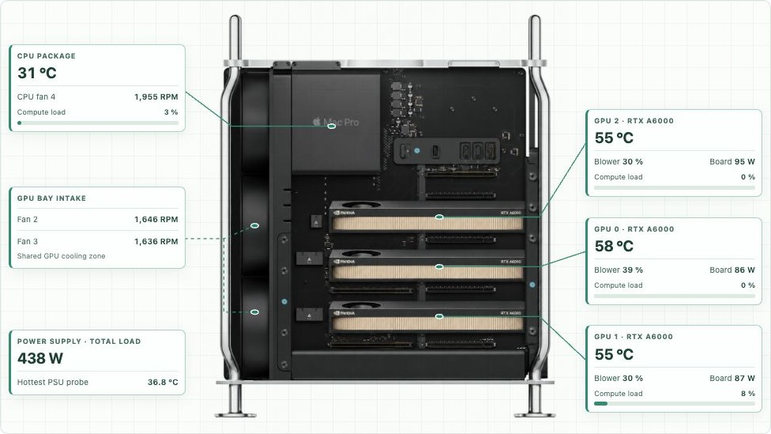
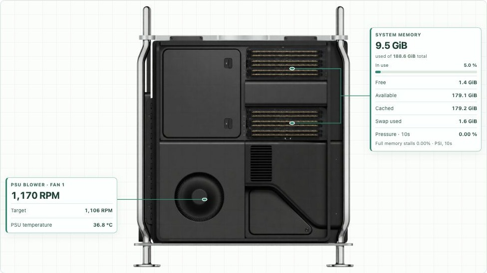
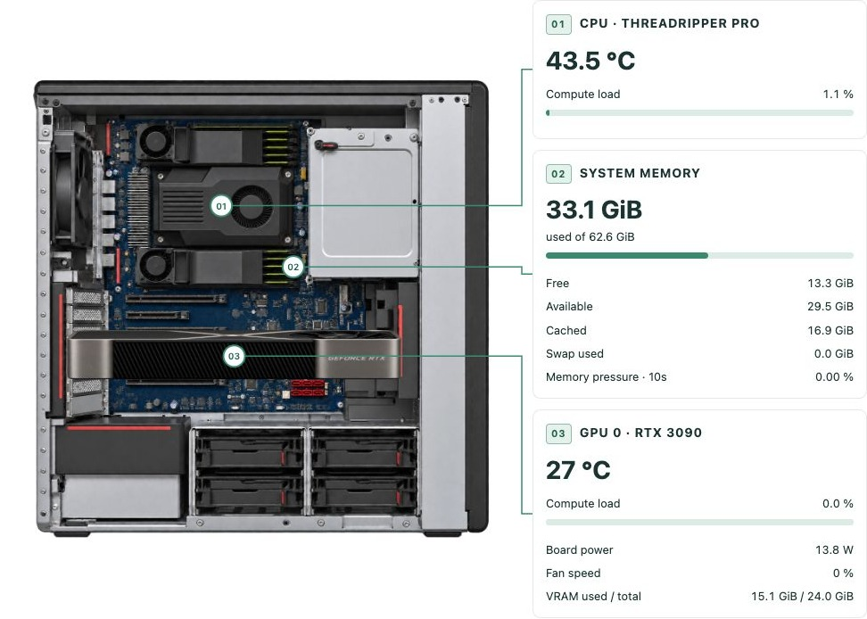

# neofand

Hardware monitoring and per-component fan control for Linux workstations.
neofand pairs a Mac Pro fan daemon with a live hardware dashboard, visual sensor
callouts, a GPU system builder, and storage topology and usage views.

The daemon drives **each fan from the component it actually cools**, for machines
where GPU workloads dominate the thermal load.

Forked from [T2FanRD](https://github.com/GnomedDev/T2FanRD) (GPL-3.0-or-later),
which curves off CPU package temperature. On a compute box that is the wrong
signal: during inference the CPU idles while the GPUs sit near their thermal
limit. neofand inverts that — GPU temperature drives the GPU fans, and the CPU is
tracked so it cannot cook unattended.

It also goes further than one curve for all fans:

- **Per-fan sensor sources.** A chassis fan on the PSU has no business following
  GPU junction temperature. Each fan picks `gpu`, `cpu`, `psu` or `gpu+cpu`.
- **The PSU fan runs off total system power**, read straight from the SMC, with
  PSU temperature as a backstop. Power leads temperature by a long way, so this
  gets air moving before the supply heats up rather than after.
- **A cover-open safety interlock.** On a Mac Pro the PSU, CPU and MPX modules are
  cooled by chassis static pressure. Taking the fans to manual control silently
  defeats the firmware's cover-off protection, which is a real hazard — see
  [Cover detection](#cover-detection-and-the-safety-interlock).

Originally written for a Mac Pro 7,1 (MacPro7,1) driving two Vega 20 dies. The
GPU/CPU sensor layer is vendor-agnostic; the SMC-backed features (cover
detection, total system power, PSU sensors) are Apple-specific and degrade to
no-ops elsewhere.

## Hardware dashboard

| Platform | What is supported | Start here |
|---|---|---|
| Mac Pro 7,1 running Linux | Apple SMC chassis cooling, NVIDIA/AMD temperature sources, PSU power, cover interlock, and two-sided sensor diagrams | [Daemon installation](#build-and-install) · [Dashboard deployment](dashboard/README.md) |
| Linux / Lenovo ThinkStation P620 | Read-only CPU, memory/PSI, hwmon, NVIDIA telemetry, storage and event snapshots; P620 sensor callouts | [Linux adapter](dashboard/linux/README.md) |
| Proxmox LXC | Native systemd web/API image with a separate physical-host collector and read-only telemetry mount | [LXC packaging](dashboard/lxc/README.md) |

The Linux adapter does not control chassis fans or invent missing PSU readings.
The LXC package has configuration/API checks; a real Proxmox container boot is
still unverified.

- **Live sensors:** CPU/GPU load bars, temperatures, GPU board power and fan duty,
  memory used/free/available/cache/swap and Linux memory pressure. Auto refresh
  and live sampling controls show the last sample time and source build.
- **Storage:** physical drives, boot/system badges, readable filesystem usage,
  unknown usage for unreadable partitions, and ZFS pool/mirror topology without
  double-counting shared capacity. Optional category indexing uses a persistent
  metadata cache and reconciliation; it is not a filesystem journal.
- **GPU system builder:** combine PCIe and Apple MPX models inside chassis views,
  with model dimensions, slot occupancy and collision checks. Artwork is
  illustrative; exact board variants, connectors and cable clearances still
  require physical verification. See the [GPU library](dashboard/assets/gpu-library/README.md).
- **History and events:** temperature/power trends and host event snapshots.
  A telemetry gap is an inferred interruption, not proof of a power failure.

### Live server screenshots

Captured from running servers on November 5, 2026. Identifying headers, hostnames,
network addresses, browser chrome and navigation are cropped out before
publication. Sensor readings are genuine samples, not generated demo values.
Chassis artwork and sensor anchor locations are illustrative.

**Mac Pro — three RTX A6000s, CPU, intake fans and total PSU load**



**Mac Pro — memory usage, pressure and PSU cooling**



**ThinkStation P620 — CPU, memory and RTX 3090**



The P620 rendering uses illustrative Founders Edition artwork; the exact board
variant and physical slot are not verified. Total PSU power and chassis fan RPM
are unavailable on that host.

## Why this exists

On the machine it was written for, the chassis fans sat pinned at their 500 RPM
minimum — with roughly 5x headroom unused — while the GPU dies ran at 93-101 °C
junction against a 100 °C limit. One die spent 62% of a sustained load throttled
below its top clock. Nothing in Linux was telling the SMC there was a 350 W load
in the machine.

With neofand driving the fans, on the same load:

| | before | after |
|---|---|---|
| top DPM level held | 38% | **100%** |
| avg junction | 99.0 °C | **89.7 °C** |
| peak junction | 101 °C (over limit) | **92 °C** |

On a 120B-parameter MoE inference benchmark, token generation went from
`75.16 ± 14.19` to `81.79 ± 0.49` t/s — **+8.8% throughput, and run-to-run
variance 29x tighter**, because the GPU stopped dropping clocks mid-run.

## Requirements

- Linux.
- A driver exposing fan control. On T2 Macs that means the patched `applesmc`;
  mainline's fails to probe with `-EIO` because the SMC moved into the T2. On
  Debian/Ubuntu install `applesmc-t2` from
  [t2-ubuntu-repo](https://github.com/AdityaGarg8/t2-ubuntu-repo) — it is a DKMS
  module, so **no kernel replacement is needed**. Do not install it alongside a
  `linux-t2*` kernel, which has it built in.
- Root, to write the fan sysfs attributes.

## Build and install

```bash
cargo build --release
sudo install -m 0755 target/release/neofand /usr/local/bin/neofand
sudo install -m 0644 neofand.service /etc/systemd/system/neofand.service
# On MacPro7,1, start from the worked config rather than the generated one:
sudo install -m 0644 neofand.conf.macpro71 /etc/neofand.conf
sudo systemctl daemon-reload
sudo systemctl enable --now neofand
```

Ubuntu's packaged `cargo` (1.75) is sufficient; no rustup needed, and the code
avoids anything newer.

Omit the config step to have `/etc/neofand.conf` generated with safe defaults on
first run — but note the generated file leaves every fan on `source=gpu+cpu`,
because neofand cannot know which fan cools what. See
[Working out which fan is which](#working-out-which-fan-is-which).

**Check the startup log before trusting it**, particularly the interlock line and
the per-fan summary:

```bash
sudo journalctl -u neofand -b --no-pager -o cat | head -20
```

```
neofand: smc 1363 keys via /sys/bus/acpi/devices/APP0001:00
neofand: cover interlock armed via MSCO (cover_mode=floor)
neofand: fan 500-1500 RPM (max overridden from 1200), source=psu, psu 45-70 C, power 250-900 W, linear, cover-open floor 1350 RPM
neofand: fan 500-2500 RPM, source=gpu, gpu 70-90 C, linear, cover-open floor 2250 RPM
```

On stop the daemon writes `fan*_manual=0`, handing the fans back to firmware
control. That is also the failure-safe state, so a crash degrades to stock
behaviour rather than leaving the fans pinned. See
[Failure paths](#failure-paths).

## Profiles

Set `profile` in `[General]`. A profile supplies the thresholds and curve; any
key you add to a `[FanN]` section overrides that profile for that fan only.

| profile | GPU ramp | CPU ramp | curve | character |
|---|---|---|---|---|
| `quiet` | 80 → 96 °C | 70 → 92 °C | exponential | Near-silent until close to the limit, then ramps hard. Accepts hotter steady-state operation. |
| `balanced` | 70 → 90 °C | 60 → 85 °C | linear | Default. The validated configuration in the table above. |
| `turbo` | 62 → 82 °C | 50 → 75 °C | logarithmic | Ramps just above idle and hits full RPM well below the limit. Maximum sustained clocks, loud. |
| `custom` | — | — | — | Apply no profile; take every value from the config file. |

Below the low threshold the fan sits at its sysfs minimum; above the high
threshold, at its maximum. In between the curve shapes the response:

- `linear` — demand maps straight through.
- `exponential` — cubed. Most of the range stays near idle RPM; late, steep ramp.
- `logarithmic` — cube root. Front-loaded ramp; air moves early.

**Thresholds are calibrated for gfx906, which throttles at 100 °C junction.** If
your GPU's limit differs, re-tune `gpu_high_temp` — every profile assumes the
high threshold sits meaningfully below the throttle point.

## Per-fan sensor sources

Set `source` in a `[FanN]` section. This is the difference between a fan that
responds to its own workload and one that follows an unrelated signal:

| `source` | driven by |
|---|---|
| `gpu` | GPU temperature only |
| `cpu` | CPU package temperature only |
| `psu` | Total system power (feed-forward) and PSU temperature, higher demand wins |
| `gpu+cpu` | Whichever of GPU or CPU asks for more. **Default** — the safe choice when a fan's role is unknown |

Each source keeps its own threshold pair (`gpu_low_temp`/`gpu_high_temp`,
`cpu_*`, `psu_*`), because sane operating points differ wildly: 90 °C junction on
gfx906 is near its 100 °C limit, while 90 °C on a CPU package means something is
badly wrong, and a PSU is unhappy well below either.

### Working out which fan is which

There is no reliable way to do this from software. SMC key names do not encode
it, and on MacPro7,1 every `fanN_label` is empty. What does work: **stall one fan
by hand and watch which `fanN_input` collapses.**

```bash
D=/sys/bus/acpi/devices/APP0001:00
while :; do for i in 1 2 3 4; do printf '%6s ' "$(cat $D/fan${i}_input)"; done; echo; sleep 1; done
```

Stop the daemon first, or it will fight you. On MacPro7,1 this established
`fan1` = PSU, `fan2`/`fan3` = MPX/GPU bays, `fan4` = CPU cooler.

`Fan1..FanN` sections are zipped **positionally** against the sorted fan sysfs
paths, so section order is the fan order — do not reorder them.

## PSU fan and total system power

A `source=psu` fan takes the higher of two demands:

- **Total system power**, SMC key `PSTR`, against `power_low_watts` /
  `power_high_watts`.
- **PSU temperature**, the hottest SMC `Tp*` channel, against `psu_low_temp` /
  `psu_high_temp`.

Power is the feed-forward term and it matters. Measured on the reference machine:
a 35 W step appeared in `PSTR` **within 1–2 seconds**, while the `Tp*` sensors had
not moved at all after 20 seconds. A curve driven by PSU temperature alone reacts
only once the supply is already hot; power lets the fan get ahead of it. The
temperature term stays as the backstop for heat arriving from anywhere else.

`PSTR` is a direct total — do **not** try to sum the individual rails
(`PC0R`, `PG0R`, …), which are nested and will overcount badly.

Set `power_low_watts` above your machine's real idle draw or the fan will never
sit at minimum. The reference machine idles at ~195 W, hence a 250 W low.

## Cover detection and the safety interlock

**This is a safety feature, not a convenience.** On MacPro7,1 the PSU, CPU and MPX
modules are cooled by chassis static pressure, not by local airflow. With the
cover off, the T2 pins the fans high to compensate — but `fan*_manual=1`
**overrides that outright.** Measured: starting the pre-fix daemon with the cover
removed drove the fans from 1195/2244/2243/2247 down to **500/442/455/452 within
20 seconds**, and they stayed there.

neofand reads SMC key **`MSCO`** (`01` = cover off, `00` = cover fitted) and acts
on it. Set `cover_mode` in `[General]`:

| `cover_mode` | behaviour with the cover off |
|---|---|
| `floor` | **Default.** Keep control, but clamp each fan to its `cover_open_rpm`. The curve still ramps *above* the floor under load. |
| `release` | Write `fan*_manual=0` and hand the fans back to firmware. Exactly stock behaviour. |
| `off` | Ignore cover state. Do not use on this hardware. |

`floor` is preferred because the firmware's cover-off ramp was only ever observed
as a **flat** 1200/2250 RPM regardless of temperature — a safety floor, not a
curve. Handing control back would therefore give up thermal responsiveness under
load. Enforcing the same floor ourselves keeps the guarantee and keeps the curve.

`cover_open_rpm` defaults to **90% of each fan's maximum**, which is where the
firmware puts fans 2–4 during its own ramp (2250 of 2500).

If `MSCO` is unavailable — no SMC, or a non-Apple machine — the interlock disables
itself, logs a warning at startup, and the daemon behaves as if the cover is
fitted. Check for that line before running with the case open.

### Failure paths

All three end with the fans back under firmware control:

- clean exit or `systemctl stop` — the daemon writes `fan*_manual=0`;
- `SIGKILL` — no cleanup runs, so `ExecStopPost` in the unit clears
  `fan*_manual` instead;
- crash — `Restart=on-failure` plus the above.

### Firmware also throttles the GPUs

Independently of fans, SMC key `GTHR` reads non-zero while the cover is off, and
the per-GPU `GT*R`/`GT*A` keys change with it. neofand logs a warning on
transition. **Any benchmark captured with the cover off is not comparable to one
captured with it fitted.** Note this is applied firmware-side; neofand cannot
affect it, only report it.

## GPU sensor selection

Configured under `[Gpu]`.

### `drivers`

Comma-separated hwmon `name` values to treat as GPUs. Default:

```ini
drivers=amdgpu,radeon,nouveau,i915,xe
```

Discovery walks `/sys/class/hwmon`, keeps nodes whose `name` matches, and reads
temperatures from them. Because it matches on the driver name rather than a
hardcoded sysfs path, AMD, Intel and nouveau all work through the same code.

**NVIDIA registers no hwmon node at all** — not in the proprietary driver and not
in the open kernel modules. It is a long-standing open feature request, and NVML
is the vendor's recommended interface. NVIDIA GPUs are therefore handled by a
separate backend; see [NVIDIA support](#nvidia-support) below. `nouveau` *does*
register hwmon and is discovered normally.

### `sensor_preference`

Which channel counts as *the* GPU temperature:

| value | meaning |
|---|---|
| `junction` | Hotspot. **Default, and the right answer on AMD** — it is what trips throttling. |
| `edge` | Package/edge temperature. |
| `memory` | Memory junction. |
| `max` | Watch every channel, hottest wins. Safest on an unfamiliar driver. |

Channels are chosen by `temp*_label`, not by index, because numbering is not
consistent between drivers — amdgpu exposes edge/junction/mem as temp1/2/3,
while nouveau and i915 typically expose a single unlabelled temp1. `junction`
falls back to an edge-labelled channel, then to the lowest-numbered channel, so
single-sensor drivers still work.

Why this matters: on the reference machine, edge read 62-71 °C while junction was
at 93-101 °C. A curve driven by edge would barely have reacted.

Sensors whose value fails to parse are dropped at startup with a warning rather
than being allowed to crash the control loop. This is not hypothetical — a
secondary AMD card on the reference machine has a `temp1_label` of `edge` but an
**empty** `temp1_input`.

### `extra_temp_paths`

Comma-separated globs appended to the auto-discovered set. The escape hatch for
GPUs with no hwmon node, or any other sensor you want included:

```ini
extra_temp_paths=/run/nvidia-temp/temp1_input,/sys/class/hwmon/hwmon*/temp4_input
```

## NVIDIA support

NVIDIA GPUs are read through **NVML**, because they expose no hwmon node. Enabled
by default; set `use_nvml=false` under `[Gpu]` to disable.

`libnvidia-ml.so` is loaded **at runtime** via `libloading`, so:

- there is no build-time or link-time NVIDIA dependency — the same binary works
  on AMD-only, NVIDIA-only and mixed machines;
- on a machine with no NVIDIA driver, initialisation fails with
  `DriverNotLoaded`, logs one line, and the backend is skipped;
- AMD and NVIDIA GPUs are read **simultaneously** in a mixed system, with the
  hottest across both driving the fans.

Build without the dependency entirely using `cargo build --release
--no-default-features`; the backend compiles to a no-op stub.

### `power_limit_watts`

Board power cap applied to every NVIDIA card at startup, in watts, under
`[Gpu]`. Default `0` leaves the driver default alone.

```ini
power_limit_watts=250
```

The driver resets power limits to the card default on every boot, so a cap set
by hand with `nvidia-smi -pl` silently disappears after a reboot. On a machine
plugged straight into the wall that brings back the full stock draw (3 x 300 W on
three A6000s). The value is clamped to the range each card accepts, and each
card's result is logged as `nvml [N] power limit ... W`. The cap is not removed
when the daemon stops: it is a safety limit, not a fan setting.

### Sensor semantics differ from AMD — read this before tuning

NVML's temperature API has exactly **one** sensor variant, `Gpu`. There is **no
hotspot/junction channel**. So on NVIDIA:

| `sensor_preference` | what you actually get |
|---|---|
| `junction` | GPU core sensor (no hotspot exists — cannot be honoured literally) |
| `edge` | GPU core sensor |
| `memory` | GPU core **plus** memory temperature, where the GPU supports it |
| `max` | same as `memory` |

Memory temperature comes from NVML field `NVML_FI_DEV_MEMORY_TEMP` and is
unsupported on many GPUs; failures are ignored rather than fatal.

### Thresholds must be re-tuned for NVIDIA

**The bundled profiles are calibrated for gfx906, which throttles at 100 °C.
NVIDIA workstation cards typically throttle well below that.** A profile that is
safe on AMD can be useless on NVIDIA — the fans would not reach maximum until the
GPU was already clocking down.

neofand reads each GPU's slowdown threshold from NVML, logs it alongside the
device, and **warns at startup** if any `gpu_high_temp` is at or above it,
suggesting a corrected value. It does not silently rewrite your config. Check the
startup log for a line like:

```
neofand: gpu sensor nvml [0] NVIDIA RTX A6000 (slowdown 93 C)
```

and set `gpu_high_temp` roughly 8 °C below that. `custom` profile plus explicit
per-fan thresholds is the cleanest way to pin NVIDIA-appropriate values.

### What this does and does not control

neofand drives **chassis/system fans**, and — with `[GpuFans] enabled=true` — the
NVIDIA cards' **own** fans as well. See [GPU fan control](#gpu-fan-control).

Chassis control is still the more important half: it makes airflow respond to GPU
load so the card has cool intake air and its exhaust actually leaves the case.
No card fan can compensate for hot intake.

## GPU fan control

Off by default. Taking fan control from the card firmware is not a safe thing to
do uninvited on every machine that happens to have an NVIDIA GPU, so it must be
asked for.

This does **not** go through X11 and `Coolbits`/`nvidia-settings`. It calls
`nvmlDeviceSetFanSpeed_v2` directly, so it works headless with no X server,
no `DISPLAY`, and no session — which matters for a daemon that starts before
anyone logs in. (`nvml-wrapper` exposes no fan setters, so the three fan entry
points are called through the raw `nvml-wrapper-sys` bindings it already
depends on. Reads and device handles still come from the safe wrapper.)

### Why it exists: the firmware curve leaves performance on the table

Measured on this hardware, 3x RTX A6000, sustained cuBLAS TF32 SGEMM on all
three cards at a 300 W per-card limit:

| | stock firmware curve | neofand `[GpuFans]` |
|---|---|---|
| GPU0 / GPU1 | 88 C at ~57% fan | **79 C at 97% fan** |
| GPU2 | 84 C | **73 C at 80% fan** |
| combined draw | 836 W | **855 W** |
| `sw-thermal` asserted | yes, GPU0+GPU1 | no |

At 88 C the top two cards picked up `sw-thermal` and fell back to 268/274 W —
*below their own power limit*. They were giving up roughly 25 W each to heat
while their blowers sat at 57%. The firmware curve is tuned to protect the card,
not to keep it at its limit, and those are different goals.

### Each card follows its own die

Per-card, not driven by the hottest card in the box. On this machine GPU2 sits
4-6 C cooler than GPU0/GPU1 purely from slot airflow, and runs its fan at 80%
while the others are at 97%. A shared curve would either over-drive GPU2 or
under-cool the other two.

### Thresholds are derived per card

With `low_temp=0`/`high_temp=0` (the default) the ramp is computed from the
slowdown threshold **NVML reports for that specific card**:

```
high_temp = slowdown - 15      # fan is at maximum before the card clocks down
low_temp  = high_temp - 25
```

The A6000s report a 95 C slowdown, giving a 55-80 C ramp. A box with mixed GPUs
gets a correct curve for each rather than one tuned to whichever card was
measured. Set either key to a non-zero value to override that half explicitly;
an inverted or nonsensical pair falls back to a conservative 50-75 C rather than
silently disabling the ramp.

A card reporting no controllable fans is skipped for control but still read for
temperature, so it continues to drive the chassis fans.

### Restoring control

Manual fan settings **persist in the driver after the process exits** — that is
NVML's behaviour, not a bug. A clean shutdown calls
`nvmlDeviceSetDefaultFanSpeed_v2` and logs `returned GPU fans to the driver
curve`. Note the asymmetry with the chassis fans: those have `ExecStopPost` in
the unit as a SIGKILL backstop, but there is no equivalent net for NVML, so a
`SIGKILL` leaves the card fans wherever they were last set. To recover, restart
the daemon and stop it cleanly, or set the fans back with `nvidia-settings`.

### GPUs NVML cannot see

For anything neither hwmon nor NVML covers, `extra_temp_paths` takes globs
pointing at any file containing a millidegree-Celsius integer — including one
written by an external poller.

## Querying it

`neofand --status` prints the daemon's complete state — every sensor, every fan,
every card — without touching it:

```console
$ neofand --status
{
  "daemon": { "version": "0.1.0", "pid": 68527, "uptime_secs": 3,
              "config_file": "/etc/neofand.conf", "profile": "turbo",
              "poll_secs": 1, "fall_samples": 20, "cover_mode": "floor",
              "holding_manual": true, "gpu_fan_control": true },
  "smc":    { "present": true, "keys": 1363, "cover_open": false,
              "gpu_throttle": false, "system_power_w": 646.9 },
  "temps": {
    "gpu": { "effective_c": 64, "sensors": [
      {"sensor": "amdgpu 0000:0b:00.0 temp2_input (junction)", "temp_c": 52},
      {"sensor": "nvml [0]", "temp_c": 64}, ... ] },
    "cpu": { "effective_c": 61, "sensors": [...] },
    "psu": { "effective_c": 47, "sensors": [{"sensor": "Tp2F", "temp_c": 47}, ...] }
  },
  "chassis_fans": [
    { "fan": 1, "source": "psu", "curve": "logarithmic",
      "target_rpm": 1348, "actual_rpm": 1344, "min_rpm": 500, "max_rpm": 1500,
      "cover_open_rpm": 1350, "always_full_speed": false,
      "deciding_input": "system_power",
      "inputs": [
        {"name": "psu_temp",     "unit": "C", "value":  47.0, "low":  45.0, "high":  70.0, "demand": 0.080},
        {"name": "system_power", "unit": "W", "value": 646.9, "low": 250.0, "high": 900.0, "demand": 0.611}
      ] }, ...
  ],
  "cards": [
    {"index": 0, "name": "NVIDIA RTX A6000", "bus_id": "00000000:14:00.0",
     "temp_c": 64, "mem_temp_c": null, "power_w": 112.3, "fans": 1,
     "controllable": true, "fan_target_pct": 55, "fan_actual_pct": 52,
     "ramp_low_c": 55, "ramp_high_c": 80, "slowdown_c": 95}, ...
  ]
}
```

The daemon republishes this every poll to `status_path` (default
`/run/neofand.status.json`); set it empty to disable. `--status` just reads that
file, so it needs no privileges and cannot disturb anything. Any other reader
works equally well — `jq . /run/neofand.status.json`, a Prometheus textfile
collector, whatever.

### Reading it

**`temps` breaks each group down per sensor**, not just the reduced maximum the
curve consumes. `effective_c` is what the curve sees, after the trailing-average
fall filter. The individual entries show which sensor is actually the hot one —
above, the gpu group reads 64 °C because of the NVIDIA cards while the two Vega
dies sit at 52 °C, which is why `fan2`/`fan3` (the MPX bays) are following the
NVIDIA cards.

**`inputs` and `deciding_input` explain each fan's speed.** A `source` maps to
one or two signals, each with its own thresholds, and the higher demand wins —
that arbitration is invisible from the resulting RPM. Above, `fan1` is at 1348
because *power* wants 0.611 while PSU temperature only wants 0.080, exactly the
feed-forward behaviour [described below](#psu-fan-and-total-system-power).

**`cards` lists every NVML card**, including any with `controllable: false` — a
card with no fan NVML will expose is still read for temperature and still drives
the chassis fans, so omitting it would hide a real heat source. `ramp_low_c` /
`ramp_high_c` are the per-card values derived from that card's own `slowdown_c`.

### target vs actual

Both are published for every fan and every card deliberately. `fan1_max`
under-reports on MacPro7,1 (see
[`max_rpm`](#max_rpm-and-why-hardware-maxima-are-not-trustworthy)), and a card can
decline a fan request, so a fan that cannot reach what it was asked for is only
visible by comparing the two. Expect a few seconds of divergence after startup
while fans spin up — that is ramp, not shortfall.

### Why a file and not a socket

`system_power_w` is SMC `PSTR`, total system power. Reaching it directly means
scanning `key_at_index` — 887 of 1363 keys on this machine — and that register is
a *single shared index*, so an external scan corrupts the daemon's own reads
mid-flight (see [`smc.rs`](src/smc.rs)). Before this existed, the only honest way
to sample total power was to stop the daemon first.

A socket would have meant a second thread touching that state, or a non-blocking
accept woven through the control loop. The file avoids both: the daemon already
reads every sensor each poll, so publishing is just serialising what it holds.
The write is temp-file-plus-`rename`, which is atomic, so a reader sees either
the previous complete snapshot or the next one — never a partial one.

## Full configuration

`/etc/neofand.conf`, generated on first run if absent.

```ini
[General]
profile=balanced          ; quiet | balanced | turbo | custom
poll_interval_secs=1      ; minimum 1
fall_samples=20           ; trailing-average window, max 60
cover_mode=floor          ; floor | release | off  — see Cover detection
status_path=/run/neofand.status.json   ; sensor snapshot; empty disables

[Gpu]
drivers=amdgpu,radeon,nouveau,i915,xe
sensor_preference=junction
extra_temp_paths=
use_nvml=true             ; NVIDIA via NVML; harmless with no NVIDIA driver

[GpuFans]                 ; the NVIDIA cards' OWN fans — see GPU fan control
enabled=false             ; off by default: takes control from card firmware
low_temp=0                ; 0 = derive per card from its slowdown threshold
high_temp=0               ; 0 = derive (slowdown - 15)
min_percent=30            ; duty floor; clamped up to 30 (below that moves no air)
max_percent=100
curve=linear              ; linear | exponential | logarithmic

[Fan1]
source=psu                ; gpu | cpu | psu | gpu+cpu   (default gpu+cpu)
power_low_watts=250       ; source=psu: total system power thresholds
power_high_watts=900
psu_low_temp=45           ; source=psu: PSU temperature backstop
psu_high_temp=70
max_rpm=1500              ; override a wrong hardware maximum; 0 = trust it
cover_open_rpm=1350       ; cover-off floor; 0 = 90% of maximum
always_full_speed=false
; Optional per-fan overrides — omit to inherit from the profile:
;   gpu_low_temp, gpu_high_temp, cpu_low_temp, cpu_high_temp, speed_curve
```

A worked example for MacPro7,1, with every value explained, is in
[`neofand.conf.macpro71`](neofand.conf.macpro71).

### `max_rpm`, and why hardware maxima are not trustworthy

`fanN_max` can simply be wrong. On MacPro7,1 `fan1_max` reports ~1200 RPM, but the
PSU fan reaches ~1350 when asked for 1600, and the firmware itself drives it to
1522 during a cover-off ramp. It also drifts by a few RPM between reads, which
makes the computed top speed wobble. `max_rpm` pins it.

Over-requesting is safe: out-of-range targets are clamped by the SMC, not
rejected.

Fan sections are generated **empty** on purpose. Writing the resolved thresholds
there would pin the fans to whichever profile was active at first run and make
`profile=` inert afterwards.

Parsing is deliberately lenient: an unknown or malformed value warns and falls
back to the profile default. A fan daemon that refuses to start because a config
key changed is worse than one that starts with sane defaults.

### Control response

Fans **rise immediately and fall slowly**. Junction temperature has been
observed climbing 92 → 101 °C in about four seconds under a dense compute load,
so a symmetric moving average would lag a spike by its entire window. Rises act
on the instantaneous reading; falls follow the `fall_samples` trailing average,
which prevents fan hunting. Expect fans to stay elevated for ~20 s after a load
ends — that is intended.

`poll_interval_secs=1` with `fall_samples=20` gives a ~20 s fall-off. Raising the
poll interval lengthens that proportionally.

## Differences from upstream T2FanRD

1. **Fan discovery.** Upstream globs `/sys/devices/pci*/*/*/*/APP0001:00/fan*`,
   which never matches on MacPro7,1 — the node is under
   `LNXSYSTM:00/.../device:1f/` and the `pci` physical-node path has no fan
   attributes. neofand anchors on `/sys/bus/acpi/devices/APP0001:00/`, a single
   stable path, with fallbacks, and canonicalises + dedupes.

   Two traps found while fixing this, both worth knowing:
   - A `**` glob over `/sys/devices` **pins a core indefinitely** — /sys is full
     of symlink cycles.
   - Widening the first component to `*` makes the same node reachable **67**
     different ways, silently breaking the positional zip of `Fan1..FanN`
     sections against discovered paths.

   Also note the applesmc hwmon node has an **empty `name`** (it uses the
   deprecated `hwmon_device_register` path), so matching hwmon by name does not
   find it.

2. **GPU-driven, multi-vendor sensors.** Upstream reads CPU package with a
   fallback hardcoded to `card0` reading `temp1` (edge). neofand discovers GPUs
   by hwmon driver name across vendors, selects channels by label, and adds an
   NVML backend for NVIDIA, which hwmon cannot see at all.

3. **CPU tracked as a floor.** Taking fans to manual stops firmware ramping them
   for the CPU, so ignoring CPU temperature would be unsafe. Separate GPU and CPU
   threshold pairs; higher demand wins.

4. **Asymmetric response.** See above. Upstream averages symmetrically.

5. **Profiles**, and lenient config parsing.

6. **Curve maths.** Upstream applies `log` directly to a temperature delta:
   at `temp == low` that is `log(0)` → `-inf`, which `as u32` saturates to 0, and
   the result is not normalised to 0..1. neofand applies curves to a normalised
   0..1 demand instead.

7. **Per-fan sensor sources.** Upstream applies one curve to every fan. neofand
   gives each fan a `source`, so the PSU fan is not chasing GPU junction
   temperature.

8. **Cover-open interlock.** Upstream has no concept of it, and taking fans to
   manual mode silently defeats the firmware's cover-off protection. Given the
   PSU and MPX modules depend on chassis static pressure, this is a genuine
   hazard rather than a missing nicety.

9. **Raw SMC key access** (`src/smc.rs`), which is what makes `MSCO` (cover),
   `PSTR` (total system power), `GTHR` (GPU throttle) and the `Tp*` PSU sensors
   reachable at all — none are exposed as hwmon channels.

Items 1, 4 and 6 are upstream bugs rather than local preferences, and would be
worth contributing back. Item 8 is arguably a safety bug in any T2 fan daemon
that takes manual control.

## Testing status

| path | status |
|---|---|
| AMD hwmon (amdgpu, junction/edge/memory/max) | **Verified on hardware** — 2x Vega 20 |
| Fan discovery, control, profiles, asymmetric response | **Verified on hardware** — MacPro7,1, 4 fans |
| Independent per-fan control | **Verified on hardware** — one fan to 80% of max left the other three at 450–500 RPM |
| Fan-to-component mapping | **Verified on hardware** — by physically stalling each fan |
| `MSCO` cover detection | **Verified on hardware** — magnet-tripped the Hall sensor, reversible, stable across repeat dumps |
| `cover_mode=floor` | **Verified on hardware** — cover off: `manual=1111`, fans held 1350/2250/2250/2250 |
| `cover_mode=release` | **Verified on hardware** — cover off: `manual=0000`, fans left on the firmware ramp |
| `PSTR` total system power | **Verified on hardware** — tracked a 35 W CPU step within 1–2 s |
| `max_rpm` above a bogus `fanN_max` | **Verified on hardware** — fan1 reached 1328 RPM against a reported 1200 max |
| PSU thresholds (`power_*`, `psu_*`) | **Not yet validated** — defaults are estimates from a 195 W idle and a 226 W CPU-only step; nothing has driven the PSU hard |
| `GTHR` actually capping GPU clocks | **Not verified** — correlates perfectly with cover state and is named like a throttle, but no cover-on vs cover-off benchmark has been run |
| NVML absent → graceful skip | **Verified** on an AMD-only machine |
| Build with and without the `nvidia` feature | **Verified** |
| NVML reading a real NVIDIA GPU | **Not yet tested** — no NVIDIA hardware available |
| nouveau / i915 / xe discovery | **Not yet tested** — code path is shared with amdgpu |

The NVML backend compiles and degrades correctly when the driver is absent, but
it has never read a live NVIDIA sensor. Treat the first run on NVIDIA hardware as
a bring-up: check the startup log lists your GPU with a plausible slowdown
threshold, confirm `fan*_input` responds under load, and re-tune thresholds per
the warning above.

## Licence

GPL-3.0-or-later, inherited from T2FanRD.
